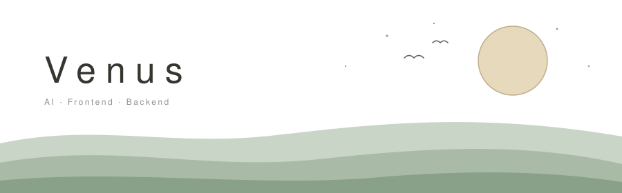

  

  A developer who likes tinkering with AI, agents, frontend and backend.

  AI 
  &nbsp;
  &nbsp;
  &nbsp;
  &nbsp;
  &nbsp;
  

  Frontend 
  &nbsp;
  &nbsp;
  

  Backend 
  &nbsp;
  

  

  <a href="https://venustzz.github.io/VenusTZZ/">Blog — venustzz.github.io</a>

  
Statistics

   
  

    
  

